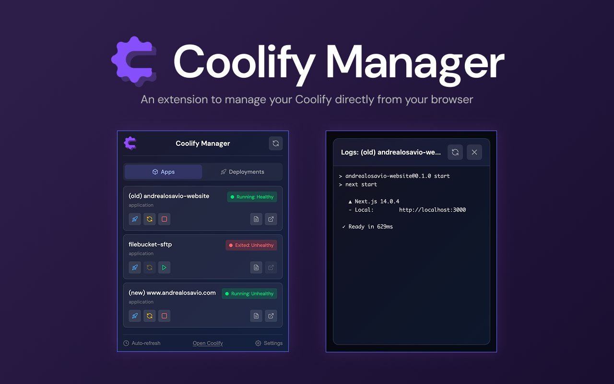

<p align="center">
  
</p>

<h1 align="center">Coolify Manager</h1>

<p align="center">
  A Chrome extension to manage your <a href="https://coolify.io/">Coolify</a> instances directly from your browser.
</p>

<p align="center">
  
 
  
</p>

<p align="center">
  
</p>

## Highlights

- Manage multiple instances of Coolify servers.
- A full popup, and an expanded three-column dashboard in a tab, on the same screen with one click.
- Applications, databases and services in one list, with status summary, filters and search.
- One-click controls for start, stop, restart and deploy, with Force Rebuild and pull latest images. Actions finish even if the popup closes.
- Live deployment view with the build log, cancel, and a rollback to a previous image.
- Database details with masked connection URLs, and scheduled backups with "Back up now".
- Service details with per-container start, stop, restart and logs.
- Live logs for applications, databases and service containers.
- Servers with health status and running resources, plus restart proxy and Docker cleanup.
- Works with every Coolify version the app supports: the API version is detected per instance, and features a server lacks are hidden or explained.
- Server URLs and API tokens are kept in `chrome.storage.sync`, so they follow your Chrome account to every browser signed in with sync on. Use a token you are comfortable having there.

## Quick Start

### From Chrome Web Store

You can download it from [here](https://chromewebstore.google.com/detail/coolify-manager/dmcclgoafojpjaflnggcnmhbenplnmpi)

### From Source (Developer Mode)

1. Clone this repository:
   ```bash
   git clone https://github.com/ontech7/coolify-manager-extension.git
   ```
2. Open Chrome and navigate to `chrome://extensions/`
3. Enable **Developer mode** (toggle in the top right corner)
4. Click **Load unpacked** and select the cloned folder

## Configure Your Server

1. Enable API Access in Coolify (Settings → Advanced → API Access).
2. Create an API token with `read`, `write`, and `deploy` permissions. `read:sensitive` is optional: it is only needed to see database connection URLs, which contain the password.
3. In the extension, open Settings, enter the server URL (https://coolify.example.com), paste the token, test the connection, and save. Testing also detects the Coolify version.

## License & Credits

MIT License. See [LICENSE](LICENSE).

Built by Andrea Losavio • [LinkedIn](https://www.linkedin.com/in/andrea-losavio/) – [Website](https://andrealosavio.com)

## Acknowledgments

- [Coolify](https://coolify.io/) - The amazing self-hostable Heroku/Netlify alternative
- [Lucide](https://lucide.dev/) - Open-source library for icons

## Disclaimer

This project is a community initiative and is not affiliated with or maintained by the official Coolify team.

---

Made with ❤️ for the Coolify community
